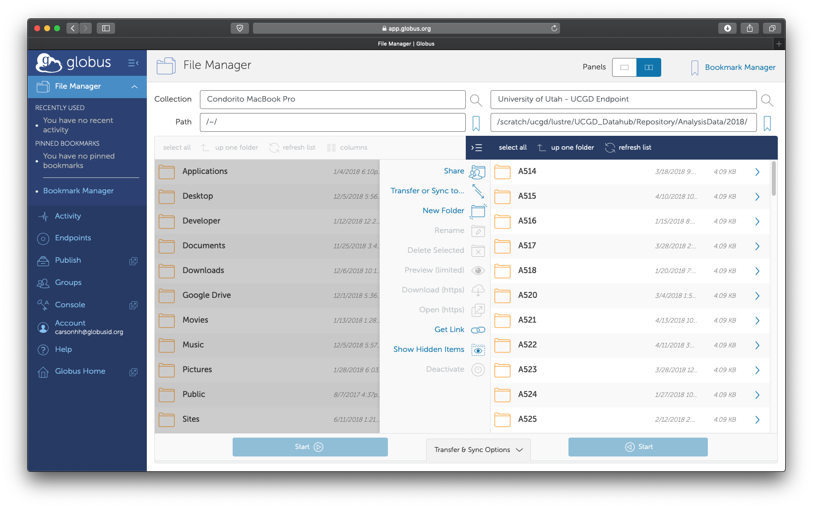
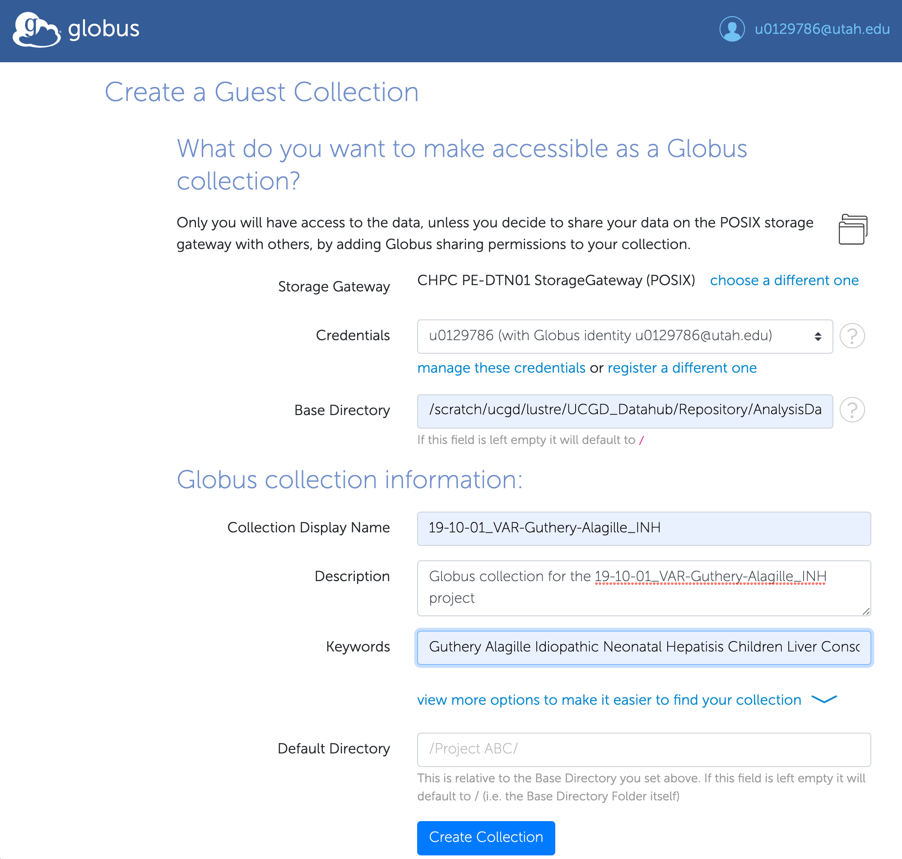
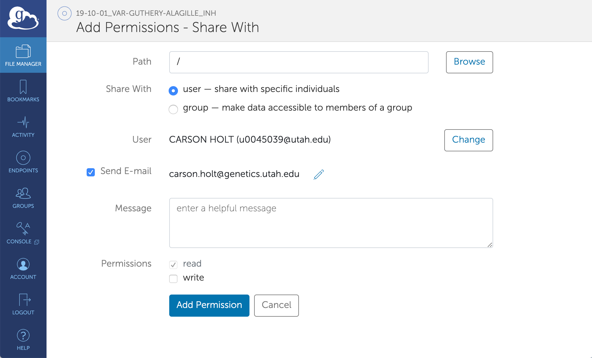

Globus is a parallelized multi-stream data transfer solution. It is used
by the NSF-funded XSEDE clusters, ENSEMBL, and US national laboratories.
Data transfer rates greater than 7 Gb/s can be achieved using Globus at
CHPC compared to \~1 Gb/s using tools like sftp, scp, and rsync. Most
importantly, data streams are encrypted and the University of Utah has a
signed Business Associate Agreement with Globus making all data
transfers HIPAA compliant.

In addition to fast data transfer, Globus also allows for easy and
secure sharing of files and directories to other individuals with
University of Utah IDs. Please use Globus as the preferred method of data
transfer into and out of the CHPC protected environment.

# Command Line and API

You can transfer using Globus via the command line, programmatically
using available APIs, or using a web browser enabled interface.
Install [Globus CLI](https://docs.globus.org/cli/) on
any server where you wish to access Globus via the command line. See
the [Globus Quick Start
Guide](https://docs.globus.org/cli/quickstart/) for more
info on using Globus CLI. To transfer files from your local
machine, you will also need to install [Globus Connect
Personal](https://www.globus.org/globus-connect-personal).

# Web interface

Go to <https://www.globus.org> to access the web interface. You can log
in with your University of Utah credentials. Use the "File Manager" to search for CHPC endpoints using
the keyword "University of Utah" or endpoints at other institutions
using keywords like "EBI" or "XSEDE". If you installed Globus
Connect Personal, you can also find your local machine.

# [Creating and Sharing a New Globus Collection](http://confluence.genetics.utah.edu/pages/viewpage.action?pageId=13828836)

Data can be shared both internally and externally by creating a new
'Collection' in Globus. This is a similar process to creating shared
endpoints that we used previously, but with a couple of less intuitive
steps.

Quick guide:

1.  Log in to Globus.
2.  Open the 'Endpoint' page.
3.  Search for and load the 'pe-dtn01' endpoint.
4.  Open the 'Collections' dialog page.
5.  Open the 'Add a Collection' dialog page.
6.  Open the 'CHPC PE-DTN01 StorageGateway (POSIX)' dialog page.
7.  Fill in the 'Base Directory', 'Collection Display Name',
    'Descriptions', and 'Key Words' (Fig. 1).
8.  Click 'Share data on this new collection with others'.
9.  Use the 'User Search' to find the user you're sharing with (make
    sure you have the correct user account!), check 'Send E-mail',
    set 'Permissions' as read and/or write, optionally set a message
    and click 'Add Permission'. (Fig. 2)

*Fig. 1 Create a Guest Collection*

*Fig. 2 Add Permissions*

