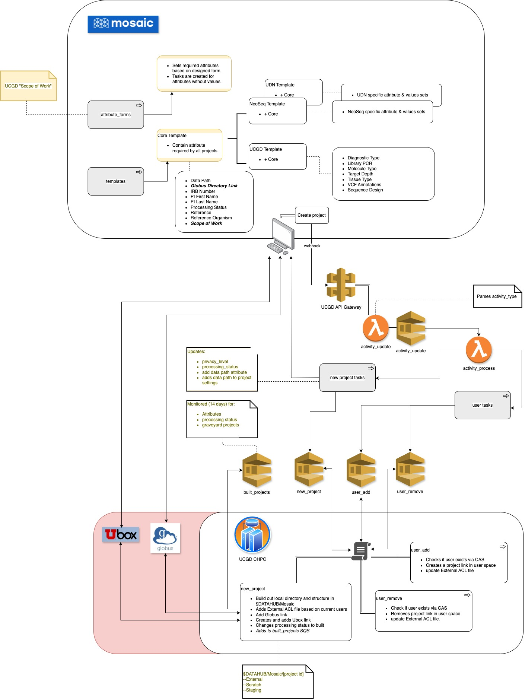

# Introduction

The UCGD-Pipeline is our fully automated processing pipeline which, at a high level, does the following:

* Uses DeepVariant-based software following the GATK best-practice approach.
* Accepts input files of BAM/CRAM/FASTQ or a combination of these.
* Utilizes multiple modern QC tools.
* Can use any number of background files for joint genotyping.
* Processes using Nextflow.
* Uses container-based (Docker & Singularity) software for HPC processing in the UCGD PE.
* Uses and requires granted access via the U of U IRB system.
* Is automated using Mosaic for project LIMS management to determine when/how processing should be done.
* Manages and stores all project data within the CHPC Protected Environment.

## Pipeline Overview

## Adding New Software

### Docker

UCGD exclusively uses [Docker](https://www.docker.com/) to manage all software for production-level processing.

In order to add specific tools to the UCGD-Pipeline, we require a
publicly accessible Docker image (Nextflow cannot access private Docker
repositories at this time), that launches into a bash environment (see below).

### Steps to add software or desired processes

Adding tools to the pipeline is as easy as creating a Docker container
with the desired software available as an executable.

1.  Create a Docker container with the desired script/software
    executable from the container command line (i.e., no ENTRYPOINT).
2.  The container must also have the following commands
    **required** by Nextflow: **awk, date, grep, egrep, ps, sed, tail, tee**.
3.  Supply the desired commands to be run (either by example or SOP)
    by the containerized software, which will be executed by Nextflow.
4.  Provide a detailed list of the final files that are expected to be ready and
    accessible at process completion.

Once we have the items listed above, the steps will be
added as automated processes.

### Container Service

UCGD uses [Docker Hub](https://hub.docker.com/u/srynobio) to store all of our current containers. If you have an issue with publicly accessible containers please contact us.

